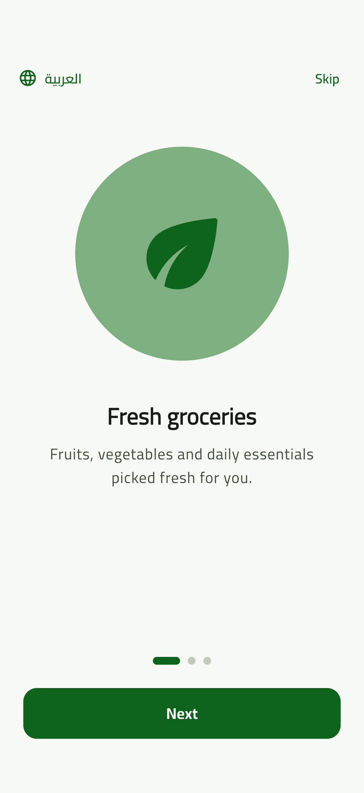
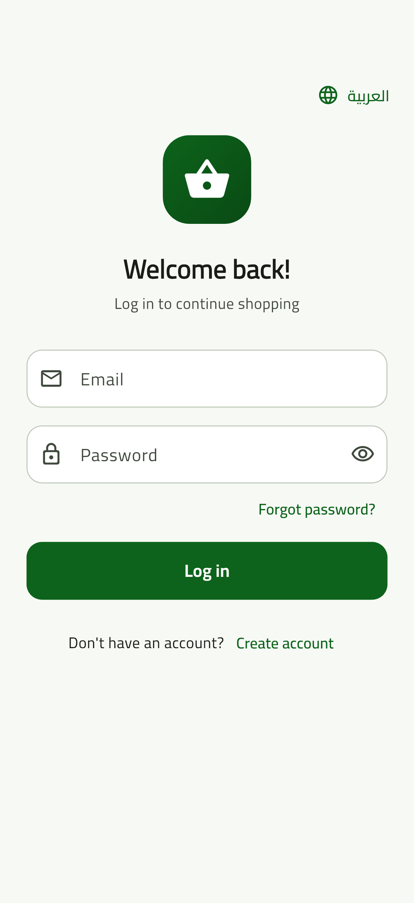
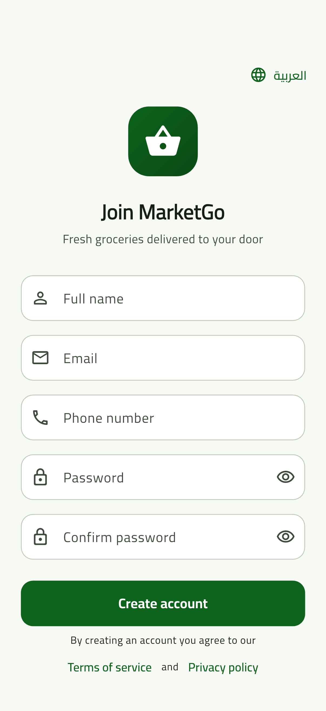
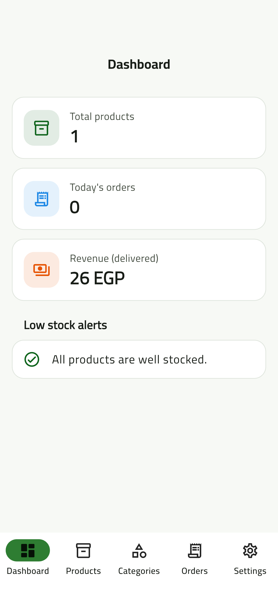
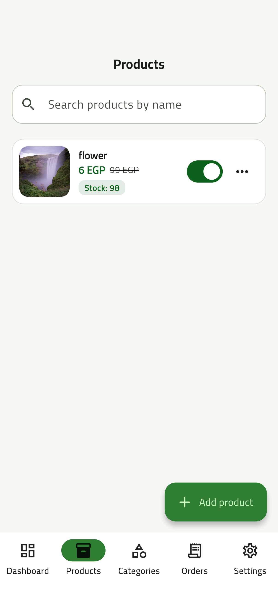
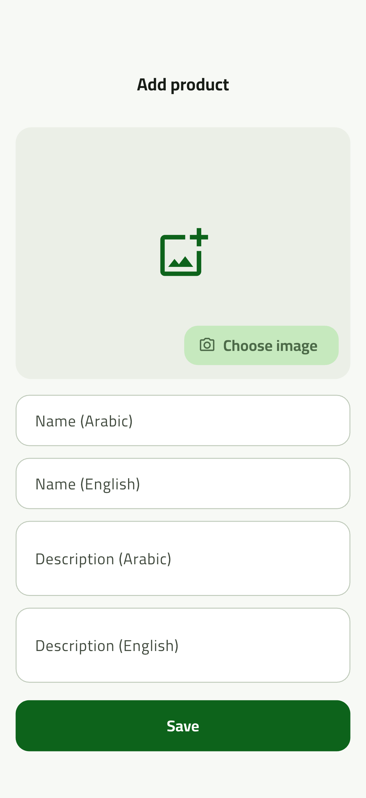
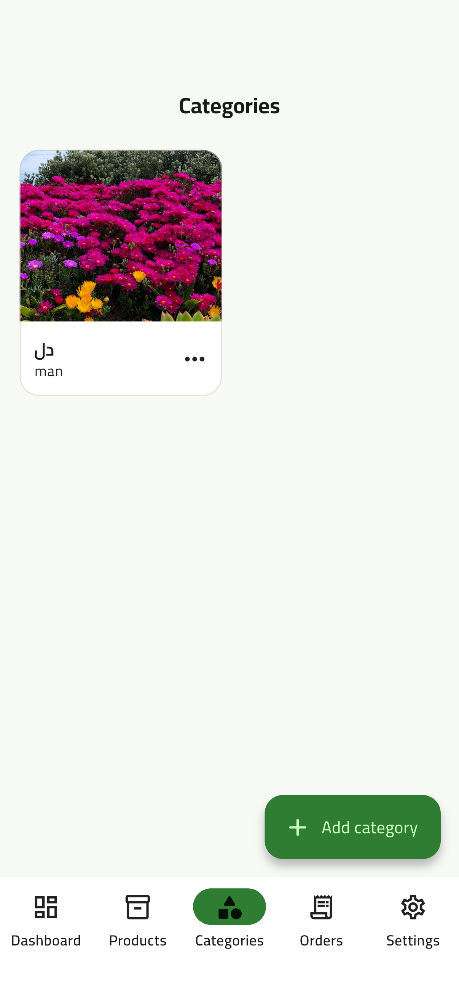
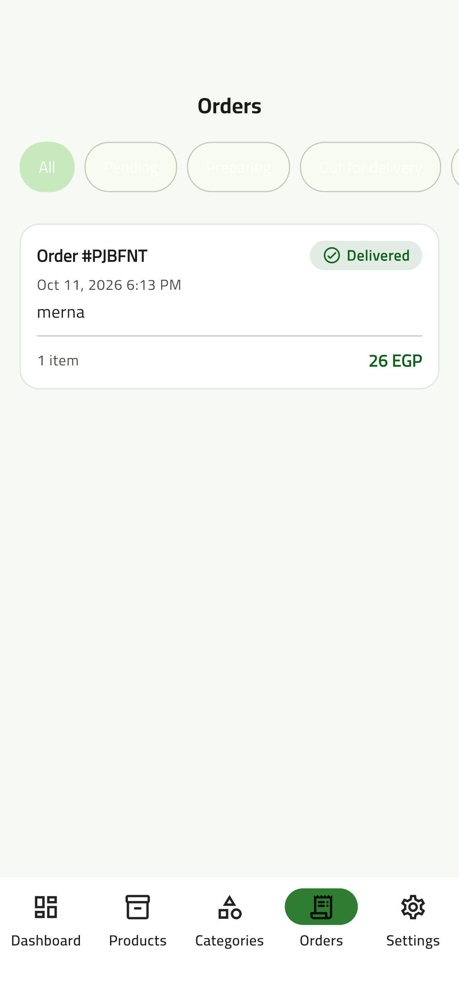
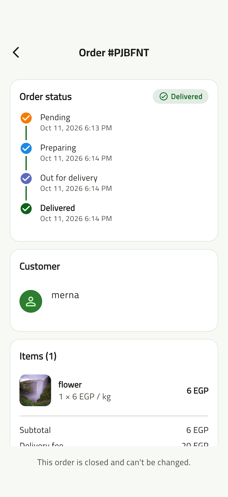
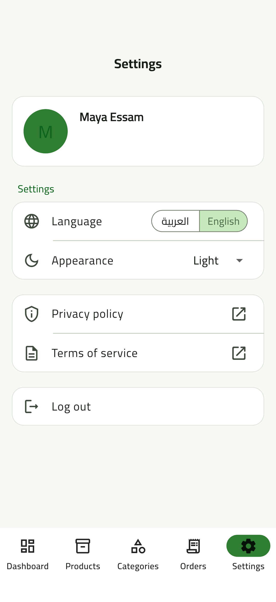

<h1 align="center">MarketGo</h1>

  A supermarket shopping app built with <b>Flutter</b> and <b>Firebase</b>, with a
  customer storefront and an admin panel in one app. 
  Arabic &amp; English · Light &amp; Dark · Phones &amp; Tablets

> 🔒 **The source code is private.** This repository only shows the project:
> features, screenshots and how it is built. Contact me if you'd like a walkthrough.

## Features

**Customers**
- Browse categories, offers and new arrivals
- Search products in Arabic or English
- Favorites saved to the account
- Cart saved on the device
- Cash-on-delivery checkout with saved addresses
- Live order tracking, and pending orders can be cancelled

**Admins**
- Dashboard: product count, today's orders, delivered revenue, low-stock alerts
- Manage products (with image upload), categories and stock
- Manage orders and update their status live (Pending → Preparing → Out for delivery → Delivered)

**Everywhere**
- Full Arabic (RTL) and English support
- Light, dark and system themes
- Responsive layouts for phones and tablets
- Works offline with cached data

## Screenshots

### Getting started

<table>
  <tr>
    <td align="center" width="33%"></td>
    <td align="center" width="33%"></td>
    <td align="center" width="33%"></td>
  </tr>
  <tr>
    <td><b>Onboarding</b>: three intro slides shown on first launch. Language can be
      switched to Arabic from the top corner, or the intro skipped.</td>
    <td><b>Login</b>: email and password sign-in with show/hide password and a
      "Forgot password?" flow that sends a reset email.</td>
    <td><b>Register</b>: create an account with name, email, phone and a confirmed
      password. Links to the Terms of service and Privacy policy.</td>
  </tr>
</table>

### Admin panel

Admins use the same app. When an account has `role: admin`, the app switches
from the storefront to the admin panel.

<table>
  <tr>
    <td align="center" width="33%"></td>
    <td align="center" width="33%"></td>
    <td align="center" width="33%"></td>
  </tr>
  <tr>
    <td><b>Dashboard</b>: total products, today's orders, revenue from delivered
      orders and low-stock alerts at a glance.</td>
    <td><b>Products</b>: search products, see price/discount and stock, hide or show
      a product with one switch, and edit or delete from the menu.</td>
    <td><b>Add / edit product</b>: image upload (Cloudinary) plus Arabic and English
      names and descriptions, price, discount, unit, stock and category.</td>
  </tr>
  <tr>
    <td align="center"></td>
    <td align="center"></td>
    <td align="center"></td>
  </tr>
  <tr>
    <td><b>Categories</b>: grid of categories with image and Arabic/English names;
      add, edit or delete them.</td>
    <td><b>Orders</b>: live list of every order with filter chips by status
      (Pending, Preparing, Out for delivery, Delivered, Cancelled).</td>
    <td><b>Order details</b>: status timeline with the time of each step, customer
      info, items and totals. Admins move the order to the next status; finished
      orders are locked.</td>
  </tr>
  <tr>
    <td align="center"></td>
    <td></td>
    <td></td>
  </tr>
  <tr>
    <td><b>Settings</b>: profile card, Arabic/English switch, light/dark/system
      theme, privacy policy, terms of service and log out.</td>
    <td></td>
    <td></td>
  </tr>
</table>

> Personal details (email and phone numbers) are hidden in the screenshots.

## Tech stack

| Area | Tools |
|---|---|
| Framework | Flutter (Dart) |
| Backend | Firebase Authentication, Cloud Firestore, Firebase Hosting |
| Images | Cloudinary |
| State management | Cubit (flutter_bloc) |
| Navigation | go_router |
| Dependency injection | get_it |
| Responsive UI | flutter_screenutil |
| Localization | flutter_localizations / intl (Arabic & English) |

## Architecture

The app follows **Clean Architecture** with one folder per feature
(auth, home, products, categories, cart, checkout, orders, favorites, profile,
settings, admin dashboard). Each feature is split into three layers:

- **Domain**: entities, repository interfaces and use cases (pure Dart)
- **Data**: models, Firebase / Cloudinary / local data sources, repository implementations
- **Presentation**: Cubits, screens and widgets

Highlights:
- Placing an order runs in a **Firestore transaction** that re-reads every product,
  uses the current prices and reserves the stock. Cancelling returns it.
- Errors are mapped once into typed failures and shown as localized messages.
- **Firestore security rules** make sure customers can only see their own data
  and only admins can manage the store.

---

Made by <a href="https://github.com/mayaessam">Maya Essam</a>

